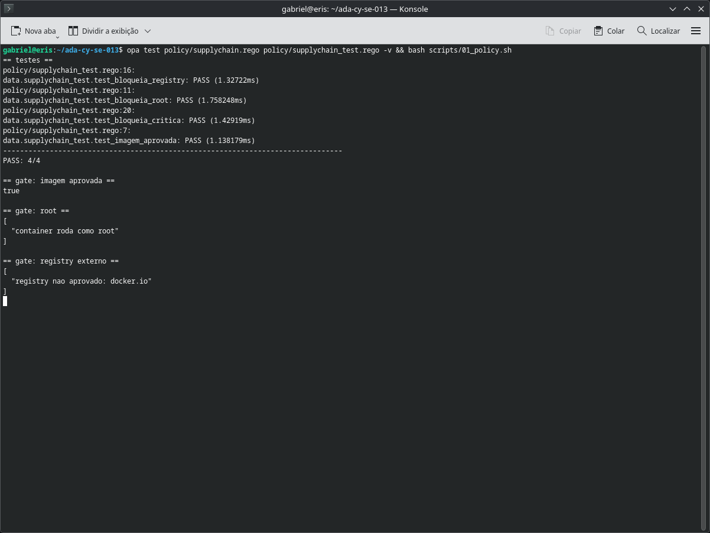
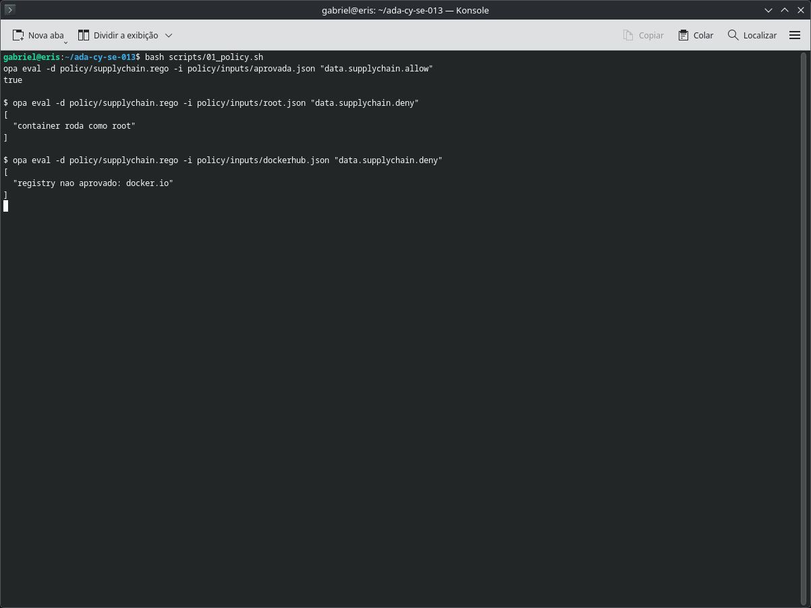
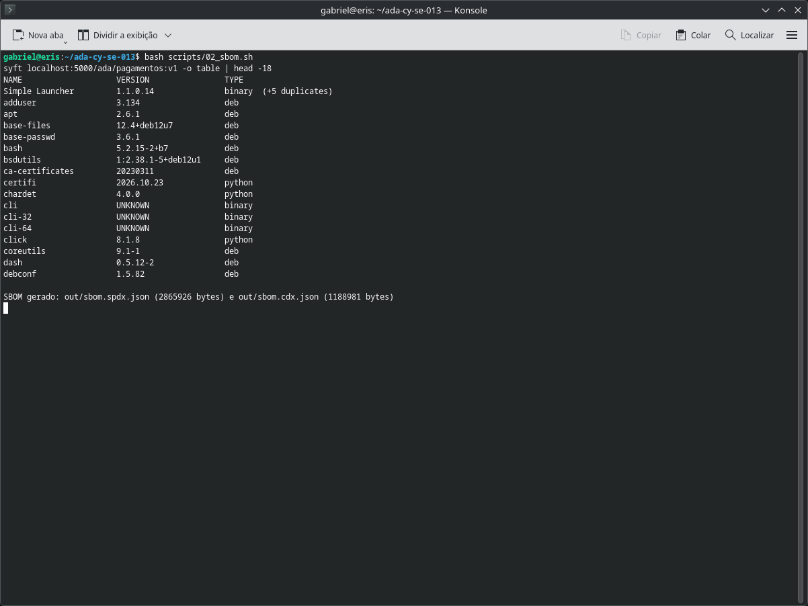
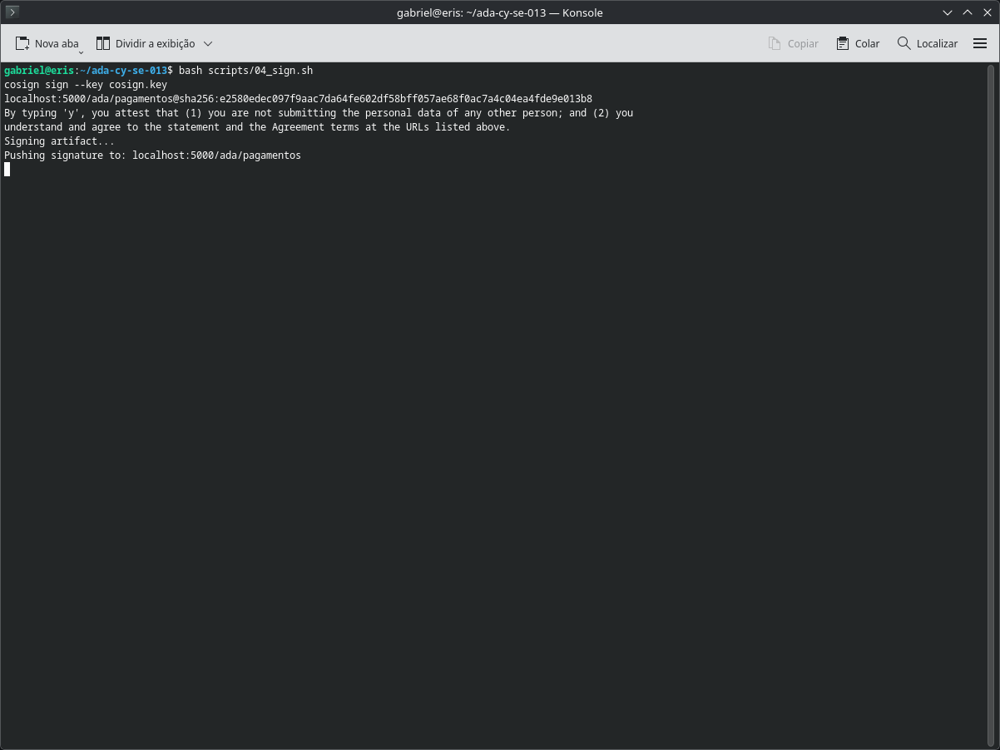
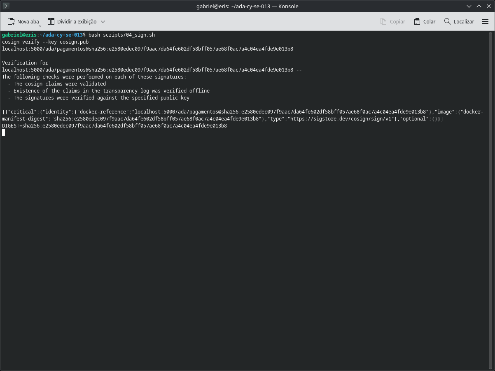
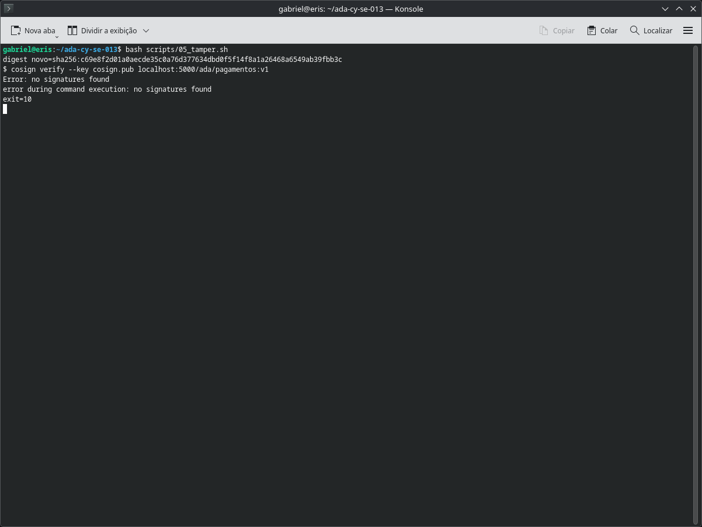
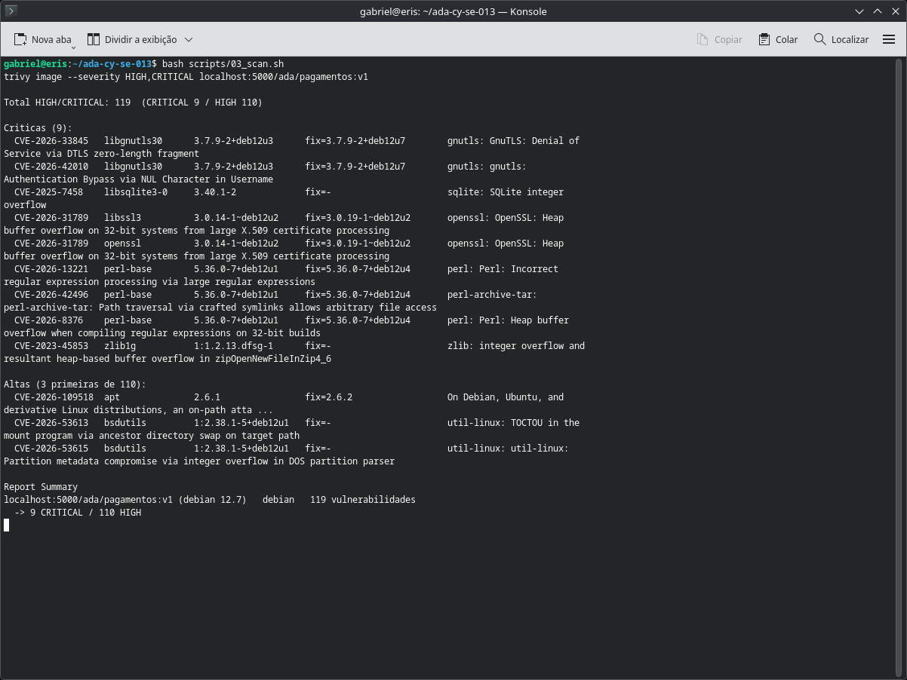

# Raio-X da Cadeia de Suprimentos - CY-SE-013

Aplicação pequena (API de pagamentos em Flask) usada para mostrar, de ponta a ponta, o antes e o depois de uma cadeia de software: sem controle ela está exposta; com as camadas do curso, o ataque é bloqueado ou evidenciado.

## Respostas

### 1. Política: Rego bloqueando root e registry não aprovado

A regra está em `policy/supplychain.rego`. Ela libera a imagem apenas quando o registry é o interno, o processo não roda como root e não existe vulnerabilidade crítica. Quando alguma condição falha, `deny` devolve o motivo exato.

```rego
allow if {
	input.image.registry == "localhost:5000"
	not roda_como_root
	not tem_critica
}
```

Os testes em `policy/supplychain_test.rego` cobrem quatro casos: imagem aprovada, root, registry externo e CVE crítica. Resultado: `PASS: 4/4`.

Teste e gate em execução:





### 2. Inventário: SBOM com Syft

O SBOM foi gerado em dois formatos a partir da imagem publicada:

- `out/sbom.spdx.json` (SPDX 2.3)
- `out/sbom.cdx.json` (CycloneDX)

São 134 pacotes inventariados, incluindo dependências do sistema operacional e do Python. É esse inventário que responde "o que exatamente rodava" quando aparece uma CVE nova.



### 3. Cadeia: ataque e assinatura com Cosign

Cenário escolhido: troca da imagem sob a mesma tag. O atacante não precisa invadir o registry para publicar outra imagem apontando para `v1`; basta ter permissão de push.

A imagem legítima foi assinada por digest:

```bash
cosign sign --key cosign.key --yes --allow-insecure-registry localhost:5000/ada/pagamentos@sha256:...
cosign verify --key cosign.pub --allow-insecure-registry localhost:5000/ada/pagamentos@sha256:...
```





Depois, uma versão adulterada foi publicada na mesma tag. O digest mudou e a verificação passou a falhar:



Resultado: `Error: no signatures found` e código de saída 10. A tag não é identidade; o digest é.

### 4. Compliance: que evidência sobra

Se a cadeia fosse atacada amanhã, o repositório responderia:

- **O que rodava:** SBOM SPDX e CycloneDX versionados, com nome, versão e licença de cada componente.
- **O que estava vulnerável:** `out/trivy.json`, com CVE, pacote, versão instalada e correção disponível.
- **Quem autorizou:** policy Rego versionada, com teste automatizado e resultado do gate.
- **O que foi publicado:** digest da imagem e assinatura verificável com `cosign.pub`.
- **Quando mudou:** cada rebuild gera outro digest; a verificação falha se a imagem não for a assinada.

O mapa completo está em [`docs/THREAT_MAP.md`](docs/THREAT_MAP.md) e no slide [`docs/THREAT_MAP.png`](docs/THREAT_MAP.png).

## Vulnerabilidade encontrada

`CVE-2026-31789` - OpenSSL 3.0.14 em `libssl3` e `openssl`, buffer overflow de heap, com correção em 3.0.19-1~deb12u2. É uma dependência transitiva: não aparece no `requirements.txt`, mas está na imagem.

No total o Trivy apontou 119 achados HIGH/CRITICAL, sendo 9 críticos.



## Checklist do projeto

| Item | Status | Onde ver |
|---|---|---|
| Policy Rego escrita e testada | feito | `policy/`, `evidence/01_policy_test.png` |
| SBOM gerado | feito | `out/sbom.spdx.json`, `out/sbom.cdx.json` |
| Vulnerabilidade real registrada | feito | `out/trivy.json`, `evidence/04_trivy.png` |
| Cosign assinando e verificando | feito | `evidence/05`, `06` e `07` |
| Caso real conectado | feito | `docs/THREAT_MAP.md` (xz-utils / SolarWinds) |

## Estrutura

```
app/       aplicação e Dockerfile propositalmente inseguro (root, base antiga)
policy/    regra Rego, testes e entradas de exemplo
scripts/   build, policy, sbom, scan, sign e tamper
evidence/  prints gerados a partir da saída real dos comandos
out/       SBOM e relatório JSON do Trivy
docs/      mapa de ameaças e relatório
```

## Como reproduzir

Pré-requisitos: Docker, OPA, Syft, Trivy e Cosign no PATH.

```bash
bash scripts/00_build.sh    # registry local, build e push
bash scripts/01_policy.sh   # testes e demonstração do gate
bash scripts/02_sbom.sh     # gera os dois SBOMs
bash scripts/03_scan.sh     # Trivy HIGH/CRITICAL
bash scripts/04_sign.sh     # assina e verifica
bash scripts/05_tamper.sh   # simula a troca de imagem
```
